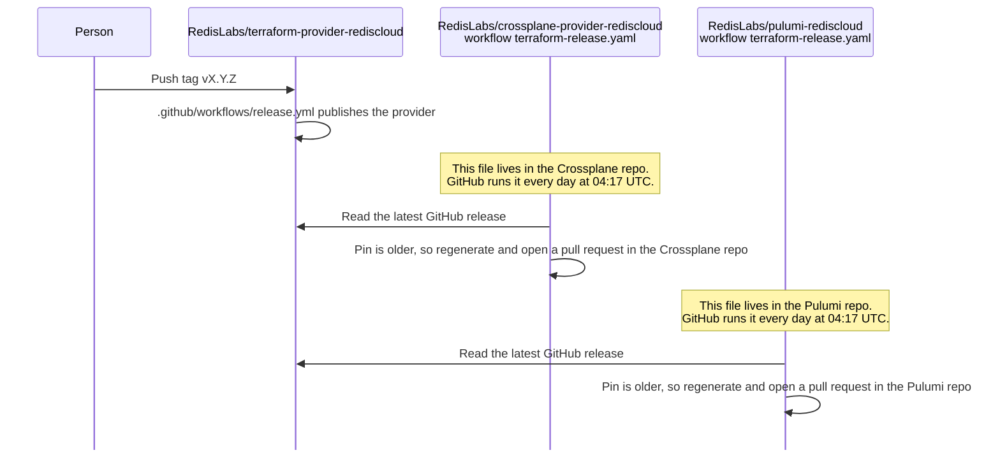
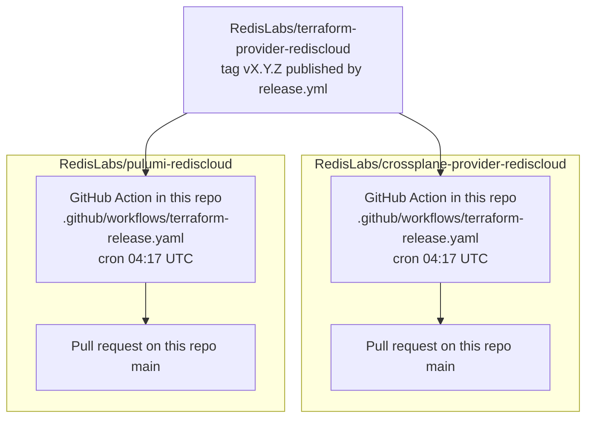

# Downstream releases for Crossplane and Pulumi

Owner: Shay Berman
Date: 2026-11-05
Status: Accepted
Ticket: none
Design: this file
ADR: none. Each downstream repository already merged the workflow. This page records how those workflows follow a release of this provider.
BDR: none.

## TLDR

A release of `RedisLabs/terraform-provider-rediscloud` does not update Crossplane or Pulumi by itself. The next morning, a job inside each of those repositories notices the new tag, regenerates from it, and opens a pull request. A person merges that pull request. Neither job publishes a Crossplane or Pulumi package.

## Problem

Crossplane and the dedicated Pulumi provider are generated from this Terraform provider. After this provider is tagged, those repositories stay on the previous pin until someone updates them. The daily jobs exist so a new tag is not missed.

## Goals

- One published release of this provider produces one pull request in Crossplane and one pull request in Pulumi.
- Each pull request moves that repository's pin and regenerates its generated code.
- The same pin opens nothing.
- A person decides whether to merge.

## Non-goals

- Merging those pull requests.
- Publishing the Crossplane package or the Pulumi registry package.
- Changing Crossplane, Upjet, Go, the Pulumi bridge, or the Pulumi SDK versions.
- Calling the Redis Cloud API.
- Updating customers who use Pulumi's generic `terraform-provider` plugin. That path has no Redis repository.

## What a release of this provider does

[RELEASE_PROCESS.md](../../RELEASE_PROCESS.md) is the process for this repository. A person merges to `main`, pushes a `v*` tag, and `.github/workflows/release.yml` publishes the GitHub release and the Terraform Registry provider.

That tag is the input the other two repositories read. Nothing outside those repositories watches the tag. Each repository contains its own GitHub Action, the file `.github/workflows/terraform-release.yaml`. GitHub runs that file every day at 04:17 UTC because the file says `cron: "17 4 * * *"`. The same file can also be started by hand from Actions → Run workflow. The tag push does not start it.

## Where the jobs live

The daily run is not a third service. It is one workflow file inside `RedisLabs/crossplane-provider-rediscloud` and a second workflow file, with the same name, inside `RedisLabs/pulumi-rediscloud`.

| | Crossplane | Pulumi |
| --- | --- | --- |
| Repository | [RedisLabs/crossplane-provider-rediscloud](https://github.com/RedisLabs/crossplane-provider-rediscloud) | [RedisLabs/pulumi-rediscloud](https://github.com/RedisLabs/pulumi-rediscloud) |
| Workflow | `.github/workflows/terraform-release.yaml` | `.github/workflows/terraform-release.yaml` |
| Script | `scripts/track_terraform_release.py` | `scripts/track_terraform_release.py` |
| Pin | `TERRAFORM_PROVIDER_VERSION` in the Makefile | `provider/go.mod`, as a pseudo-version. Go rejects the `v2` tag because the module path has no `/v2` suffix |
| Generate | `make generate` | `go mod tidy`, `make tfgen`, `make build_go` |
| Branch | `track/terraform-provider-<version>` | `track/terraform-provider-v<version>` |
| Who opens the pull request | `github-actions[bot]` | `github-actions[bot]` |
| Configured | [Pull request 5](https://github.com/RedisLabs/crossplane-provider-rediscloud/pull/5), merged 27 October 2026 | [Pull request 8](https://github.com/RedisLabs/pulumi-rediscloud/pull/8), merged 2 November 2026, expanded by [pull request 9](https://github.com/RedisLabs/pulumi-rediscloud/pull/9) on 3 November 2026 |

Both workflows leave the pull request open. Crossplane's job does not change the Crossplane, Go, or Upjet versions. Pulumi's job does not change the bridge, Go, or Pulumi versions. Generation runs without the token that pushes the branch.

## What customers get

Merging the Crossplane pull request updates Crossplane `main`. It does not publish a Crossplane release.

Merging the Pulumi pull request updates Pulumi `main`. Customers still install the Pulumi registry package from the last tag. That package is v1.3.5, published 20 December 2023, built from Terraform provider v1.3.1. A new Pulumi package is published only when someone pushes a `v*.*.*` tag in `pulumi-rediscloud`, which starts that repo's `release.yaml`.

## Example from Terraform v2.20.0

v2.20.0 was published on 4 November 2026 at 07:29 UTC, after that morning's poll. The 5 November poll was the first one that could see it.

| Repository | Run | Pull request | Opened |
| --- | --- | --- | --- |
| Crossplane | schedule | [28, Bump Terraform provider to v2.20.0](https://github.com/RedisLabs/crossplane-provider-rediscloud/pull/28) | 04:24 UTC |
| Pulumi | [41967478167](https://github.com/RedisLabs/pulumi-rediscloud/actions/runs/41967478167), schedule | [12, Track Terraform provider v2.20.0](https://github.com/RedisLabs/pulumi-rediscloud/pull/12) | 04:26 UTC |

The 3 November and 4 November Pulumi runs finished without a pull request because v2.20.0 did not exist yet.

## Operational notes

- A manual run accepts a tag and a dry run. Dry run prints the decision and does not open a pull request.
- An open pull request for the same version is left alone. A branch that was pushed without a pull request is reused on the next run.
- The job reads the public GitHub release. It does not use Redis Cloud credentials.

## Rollback

Close the downstream pull request and delete its `track/terraform-provider-*` branch. `main` in that repository stays on the previous pin. This provider's release is unchanged.

## Open questions

None. Merging the v2.20.0 pull requests is a review of those pull requests, not a change to this process.
